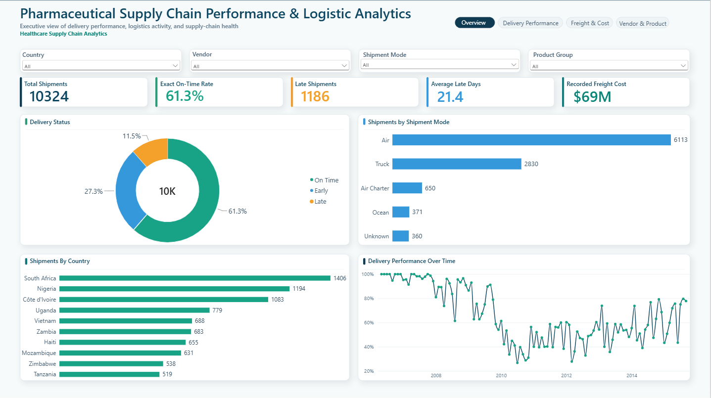
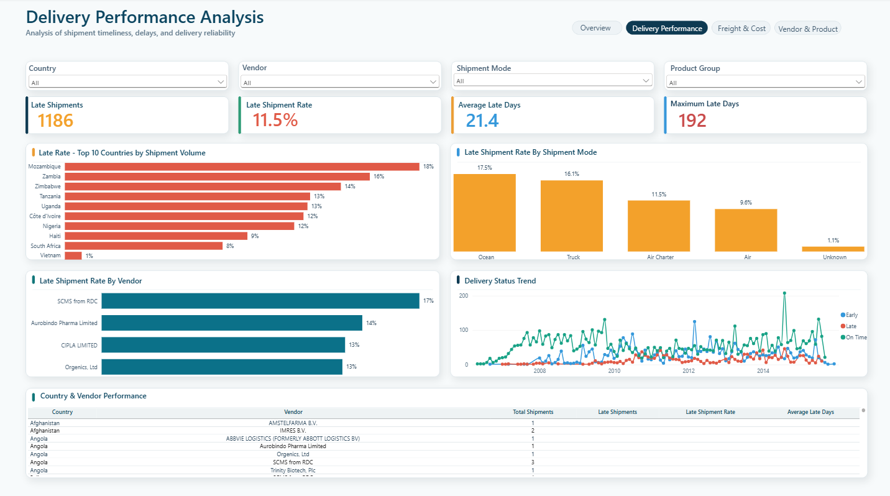
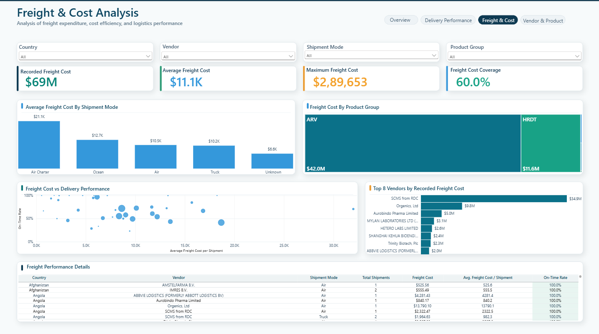
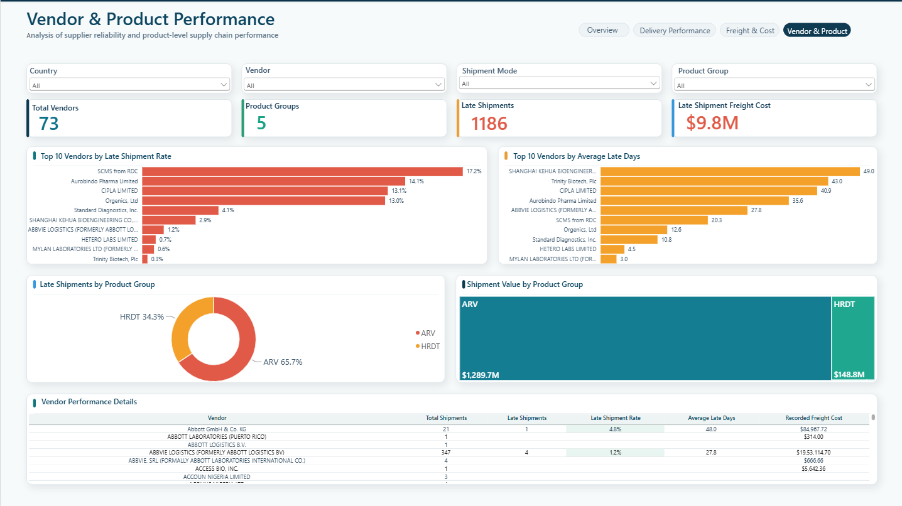

# Pharmaceutical Supply Chain Performance & Logistics Analytics

### PostgreSQL | SQL | Power BI | Power Query | DAX | Healthcare Analytics | Supply Chain Analytics

A complete end-to-end analytics project evaluating **pharmaceutical delivery performance, logistics cost, vendor reliability, shipment modes, destination countries, and healthcare product performance** using PostgreSQL and Power BI.

The project analyzes **10,324 pharmaceutical supply-chain records across 43 countries and 73 vendors**, transforming raw shipment data into an interactive four-page Power BI dashboard designed to support operational and supply-chain decision-making.

---

## Executive Summary

Healthcare supply chains depend on reliable delivery of medicines and diagnostic products across countries, vendors, and transportation networks.

The objective of this project was to answer questions such as:

- How reliably are healthcare products delivered against their scheduled dates?
- Which vendors have higher late-delivery rates?
- Which destination countries experience the greatest delivery challenges?
- How does delivery performance differ across Air, Truck, Ocean, and Air Charter shipments?
- Which transportation methods have the highest freight costs?
- Which pharmaceutical product groups represent the largest shipment value?
- How much freight cost is associated with late deliveries?
- Where should supply-chain teams focus further investigation?

The solution uses **PostgreSQL for data profiling, cleaning, transformation, KPI development, and business analysis**, followed by **Power BI for interactive reporting and business storytelling**.

---

# Project Architecture

```text
Raw CSV
   │
   ▼
PostgreSQL
   │
   ├── raw_shipments
   │       Original source data
   │
   ├── clean_shipments
   │       Cleaned and transformed analytical data
   │
   └── powerbi_shipments
           Final reporting view
           │
           ▼
       Power BI
           │
           ├── Executive Overview
           ├── Delivery Performance Analysis
           ├── Freight & Cost Analysis
           └── Vendor & Product Performance
```

This layered approach preserves the original dataset while separating data cleaning and reporting logic from the raw source.

---

# Dataset Overview

| Metric | Value |
|---|---:|
| Supply-chain records | **10,324** |
| Destination countries | **43** |
| Vendors | **73** |
| Product groups | **5** |
| Dataset period | **2006–2015** |
| Numeric freight-cost coverage | **60.03%** |

The dataset includes healthcare products such as:

- ARV medicines
- HIV rapid diagnostic tests
- Malaria diagnostic tests
- Malaria treatment products
- Adult and pediatric pharmaceutical products

Each row represents a **healthcare supply-chain line record** rather than automatically being treated as a completely independent physical shipment.

---

# Business Problem

Healthcare supply-chain managers need visibility into both **delivery reliability and logistics cost**.

A shipment arriving late may create operational risk, while high freight expenditure may indicate opportunities for transportation or vendor review.

The project therefore focuses on four analytical areas:

### Delivery Performance
Measure early, exact on-time, and late delivery performance.

### Vendor Performance
Compare major vendors using shipment volume, late-delivery rate, delay severity, and freight cost.

### Logistics & Freight
Analyze transportation methods and recorded freight expenditure.

### Healthcare Product Performance
Understand shipment activity, product value, and delivery performance across pharmaceutical product groups.

---

# Data Profiling & Cleaning

The raw dataset was first imported into PostgreSQL without manually cleaning the CSV.

The original source was preserved in `raw_shipments`, while transformations were performed separately in `clean_shipments`.

### Row Validation

```text
CSV records          = 10,324
PostgreSQL records   = 10,324
Unique IDs           = 10,324
Duplicate IDs        = 0
```

No rows were lost during ingestion.

---

## Missing Shipment Mode

The dataset contained:

```text
360 missing shipment modes
3.49% of all records
```

Further investigation showed that **312 of these records were associated with SCMS from RDC**.

However, that vendor used multiple transportation methods including:

- Air
- Truck
- Air Charter
- Ocean

Therefore, replacing missing values with the most common mode would have introduced false information.

### Cleaning Decision

```text
NULL shipment mode → "Unknown"
```

No shipment records were deleted.

---

## Missing Dosage

There were:

```text
1,736 missing dosage values
```

Instead of treating these as bad data, the missing values were analyzed by healthcare product type.

```text
HIV Test                 1,567
HIV Test - Ancillary       161
Malaria Test Kits             8
```

All missing dosage records belonged to diagnostic/test products where pharmaceutical dosage was not applicable.

### Cleaning Decision

```text
NULL dosage → "Not Applicable"
```

This avoided incorrectly deleting valid healthcare records or assigning artificial dosage values.

---

## Missing Insurance Cost

There were:

```text
287 missing insurance-cost values
```

These were retained as NULL because:

```text
NULL ≠ $0
```

A missing value means the cost is unknown or unavailable, while zero would mean that the insurance cost is known to be exactly $0.

---

# Date Cleaning

Important delivery dates were originally stored as text.

Example:

```text
2-Jun-06
```

These were converted into proper PostgreSQL `DATE` fields:

```text
2-Jun-06 → 2006-06-02
```

Cleaned date fields included:

- Scheduled Delivery Date
- Delivered to Client Date
- Delivery Recorded Date

Additional procurement-date columns contained mixed values such as:

```text
Pre-PQ Process
Date Not Captured
N/A - From RDC
```

Only valid dates were converted. Non-date business values were preserved as missing dates rather than artificially converted.

---

# Delivery Performance Logic

Delivery performance was calculated using:

```text
Actual Delivery Date - Scheduled Delivery Date
```

### Classification

```text
Difference < 0  → Early
Difference = 0  → On Time
Difference > 0  → Late
```

This generated a reusable `delivery_status` field for SQL analysis and Power BI.

---

# Core Delivery KPIs

| KPI | Result |
|---|---:|
| Exact On-Time Records | **6,324** |
| Exact On-Time Rate | **61.26%** |
| Early Records | **2,814** |
| Early Rate | **27.26%** |
| Late Records | **1,186** |
| Late Shipment Rate | **11.49%** |
| Average Late Days | **21.37 days** |
| Maximum Late Days | **192 days** |

Approximately **11 out of every 100 delivery records were delivered after their scheduled date**.

---

# Shipment Mode Performance

| Shipment Mode | Total Records | Late Rate | Avg. Late Days |
|---|---:|---:|---:|
| Ocean | 371 | **17.52%** | **39.89** |
| Truck | 2,830 | **16.08%** | 17.59 |
| Air Charter | 650 | **11.54%** | 12.79 |
| Air | 6,113 | **9.60%** | 23.30 |
| Unknown | 360 | 1.11% | 27.75 |

### Insight

Among known transportation methods, **Ocean had the highest late-delivery rate and the greatest average delay when late**.

Air had the highest shipment volume, meaning that even with a lower late-delivery rate, it still represented a large number of delayed records.

---

# Vendor Performance Analysis

Vendor performance was evaluated using:

- Total shipment records
- Late shipment records
- Late shipment rate
- Average late days
- Average recorded freight cost

To avoid misleading comparisons caused by very small samples, primary vendor late-rate visuals use:

```text
Minimum shipment threshold = 50 records
```

### Selected Vendor Results

| Vendor | Records | Late Rate | Avg. Late Days |
|---|---:|---:|---:|
| SCMS from RDC | 5,404 | **17.15%** | 20.26 |
| Aurobindo Pharma Limited | 668 | **14.07%** | 35.56 |
| CIPLA LIMITED | 175 | **13.14%** | 40.91 |
| Orgenics, Ltd | 754 | **13.00%** | 12.58 |
| S. BUYS WHOLESALER | 715 | **1.54%** | 23.36 |

### Insight

SCMS from RDC combined **high shipment volume with a relatively high late-delivery rate**.

CIPLA showed a different risk pattern: its late-delivery rate was lower than SCMS from RDC, but when deliveries were late, the average delay was substantially larger.

This demonstrates the importance of evaluating both:

```text
Frequency of delay
+
Severity of delay
```

---

# Country Delivery Performance

Country performance was evaluated using shipment volume, late rate, and average delay.

Examples from countries with sufficient shipment volume:

| Country | Late Rate | Avg. Late Days |
|---|---:|---:|
| Burundi | **38.78%** | 11.24 |
| Congo, DRC | **24.92%** | **65.59** |
| Mozambique | **18.38%** | 20.99 |
| Zambia | **15.81%** | 16.11 |
| Zimbabwe | **14.31%** | 15.56 |
| South Africa | 8.18% | **40.30** |

### Insight

Burundi showed a higher frequency of late delivery records.

Congo, DRC showed a different issue: although its late rate was lower than Burundi, late records were delayed by approximately **65.6 days on average**.

This distinction highlights the difference between:

```text
Delay Frequency
vs.
Delay Severity
```

---

# Freight Cost Data Cleaning

The raw freight-cost field contained both numeric values and business text.

Examples included:

```text
9736.10
6147.18
Freight Included in Commodity Cost
Invoiced Separately
See DN-304...
See ASN-32231...
```

The field therefore could not safely be converted directly into a numeric column.

The non-numeric records were classified as:

| Freight Type | Records |
|---|---:|
| See DN Reference | **1,937** |
| Freight Included in Commodity Cost | **1,442** |
| See ASN Reference | **508** |
| Invoiced Separately | **239** |
| Unexplained | **0** |

A separate numeric freight column was created for valid values while preserving the original business information.

---

# Freight KPIs

| KPI | Result |
|---|---:|
| Records with Numeric Freight Cost | **6,198** |
| Numeric Freight Coverage | **60.03%** |
| Recorded Numeric Freight Cost | **$68.82M** |
| Average Recorded Freight Cost | **$11.1K** |
| Maximum Recorded Freight Cost | **$289.7K** |
| Freight Cost Associated with Late Shipments | **~$9.8M** |

> Freight cost metrics represent records where a directly usable numeric freight value is available. They should not be interpreted as complete logistics expenditure for every record in the dataset.

---

# Average Freight Cost by Shipment Mode

| Shipment Mode | Avg. Recorded Freight Cost |
|---|---:|
| Air Charter | **$21.1K** |
| Ocean | **$12.7K** |
| Air | **$10.5K** |
| Truck | **$10.2K** |
| Unknown | **$6.6K** |

### Insight

Air Charter had the highest average recorded freight cost.

Regular Air handled much greater shipment volume, demonstrating why logistics decisions should consider both:

```text
Average Cost
+
Shipment Volume
```

---

# Healthcare Product Analysis

Five healthcare product groups were represented in the dataset:

| Product Group | Description |
|---|---|
| ARV | HIV treatment medicines |
| HRDT | HIV rapid diagnostic tests |
| MRDT | Malaria rapid diagnostic tests |
| ACT | Malaria treatment medicines |
| ANTM | Other malaria-related products |

---

# Product Group Value

| Product Group | Recorded Item Value |
|---|---:|
| ARV | **$1.431B** |
| HRDT | **$213.3M** |
| ACT | **$664K** |
| ANTM | **$274K** |
| MRDT | **$81K** |

ARV products clearly dominate the dataset in both shipment activity and recorded product value.

The item-value logic was independently validated using:

```text
Line Item Quantity × Pack Price ≈ Line Item Value
```

---

# Product Delivery Performance

| Product Group | Records | Late Records | Late Rate |
|---|---:|---:|---:|
| ARV | 8,550 | 1,073 | **12.55%** |
| HRDT | 1,728 | 113 | **6.54%** |
| ACT | 16 | 0 | 0% |
| ANTM | 22 | 0 | 0% |
| MRDT | 8 | 0 | 0% |

The smaller product groups contain very few records, so their 0% late rates should not be interpreted as evidence of perfect delivery performance.

---

# Power BI Dashboard

The final dashboard contains four report pages.

## 1. Executive Overview

Provides a high-level view of overall pharmaceutical supply-chain performance.

Key elements include:

- Total Shipments
- Exact On-Time Rate
- Late Shipments
- Average Late Days
- Recorded Freight Cost
- Delivery Status
- Shipment Mode Distribution
- Shipments by Country
- Delivery Performance Trend



---

## 2. Delivery Performance Analysis

Focuses on shipment reliability and delays.

Analysis includes:

- Late Shipments
- Late Shipment Rate
- Average Late Days
- Maximum Late Days
- Late Rate by High-Volume Countries
- Vendor Late Shipment Rate
- Shipment Mode Late Rate
- Delivery Status Trend
- Country & Vendor Performance Matrix



---

## 3. Freight & Cost Analysis

Analyzes transportation cost and logistics efficiency.

Includes:

- Recorded Freight Cost
- Average Freight Cost
- Maximum Freight Cost
- Freight Cost Coverage
- Average Freight Cost by Shipment Mode
- Freight Cost by Product Group
- Freight Cost vs Delivery Performance
- Top Vendors by Recorded Freight Cost
- Detailed Freight Performance Matrix



---

## 4. Vendor & Product Performance

Combines supplier reliability with healthcare product analysis.

Includes:

- Total Vendors
- Product Groups
- Late Shipments
- Late Shipment Freight Cost
- Vendor Late Shipment Rate
- Average Vendor Delay
- Late Shipments by Product Group
- Product Group Shipment Value
- Vendor Performance Matrix



---

# Power BI Design Features

The dashboard includes:

- Interactive slicers
- Cross-filtering
- Navigation buttons
- KPI cards
- Conditional formatting
- Top-N filters
- Minimum-volume vendor filtering
- Line charts
- Bar charts
- Donut charts
- Treemaps
- Scatter analysis
- Detailed performance matrices

Late shipment rates use rule-based conditional formatting:

```text
0% to <10%      → Green
10% to <20%     → Yellow
20% to 100%     → Red
```

This provides quick visual identification of higher-risk segments.

---

# Key Business Insights

### 1. Delivery Reliability Requires Attention

**11.49% of delivery records were late**, with late shipments averaging approximately **21.4 days** behind schedule.

### 2. Ocean and Truck Show Higher Delay Rates

Ocean recorded the highest late rate among known shipment modes at **17.52%**, followed by Truck at **16.08%**.

### 3. Vendor Performance Varies Significantly

High-volume vendors showed materially different delivery reliability and delay severity, supporting the need for vendor-specific performance monitoring.

### 4. Delay Frequency and Severity Are Different

Some countries experienced delays frequently, while others had fewer delays but much longer delay durations.

### 5. Air Charter Is the Highest-Cost Shipment Mode

Air Charter showed an average recorded freight cost of approximately **$21.1K**, significantly higher than other transportation modes.

### 6. ARV Products Dominate Supply-Chain Activity

ARV products represent the majority of records and approximately **$1.43B in recorded product value**.

### 7. Freight Data Coverage Must Be Considered

Only **60.03%** of records contain directly usable numeric freight-cost values, making data coverage an important consideration when interpreting logistics-cost metrics.

---

# Business Recommendations

Based on the patterns identified in the dataset:

- Monitor high-volume vendors with elevated late-delivery rates.
- Investigate destination countries with both frequent and severe delays.
- Review Ocean and Truck routes where late-delivery rates are comparatively higher.
- Evaluate Air Charter usage when lower-cost shipment alternatives may be operationally appropriate.
- Give greater visibility to high-value healthcare product groups exposed to delivery delays.
- Improve freight-cost data capture so logistics-cost analysis can cover a larger percentage of shipment records.
- Use vendor scorecards combining shipment volume, late rate, delay severity, and freight cost rather than evaluating suppliers using a single KPI.

These recommendations identify areas for further operational investigation rather than claiming direct causation from the dataset alone.

---

# SQL Skills Demonstrated

- Data profiling
- Data validation
- NULL analysis
- Duplicate checks
- CASE WHEN
- GROUP BY
- HAVING
- Aggregations
- Date conversion
- Data-type casting
- Conditional logic
- Text cleaning
- Calculated fields
- Vendor and country segmentation
- KPI development
- SQL views
- Business analysis

---

# Power BI Skills Demonstrated

- Data modeling
- PostgreSQL connectivity
- Power Query
- DAX measures
- KPI development
- Interactive slicers
- Top-N filtering
- Conditional formatting
- Cross-filtering
- Navigation design
- Dashboard layout
- Business storytelling
- Executive reporting

---

# Repository Structure

```text
pharmaceutical-supply-chain-analytics/
│
├── README.md
│
├── data/
│   └── pharmaceutical_supply_chain_raw.csv
│
├── sql/
│   └── pharmaceutical_supply_chain_analysis.sql
│
├── powerbi/
│   └── pharmaceutical_supply_chain_dashboard.pbix
│
├── dashboard-images/
│   ├── 01_executive_overview.png
│   ├── 02_delivery_performance.png
│   ├── 03_freight_cost_analysis.png
│   └── 04_vendor_product_performance.png
│
└── documentation/
    └── project_summary.md
```

---

# Project Limitations

This analysis should be interpreted with several limitations:

- The dataset is historical, covering approximately 2006–2015.
- Each row represents a supply-chain line record and should not automatically be interpreted as a unique physical shipment.
- Only 60.03% of records contain directly usable numeric freight-cost values.
- Extremely early delivery records were preserved instead of being arbitrarily removed.
- The dataset does not contain warehouse inventory, reorder point, safety stock, or expiry-date inventory information.
- Vendor and country performance patterns identify areas for investigation but do not prove the cause of delays.

For this reason, the project focuses on **pharmaceutical supply-chain performance, delivery reliability, logistics cost, vendor analysis, and healthcare product analytics** rather than inventory optimization.

---

# Key Takeaway

This project demonstrates how raw healthcare supply-chain data can be transformed into actionable business intelligence using SQL and Power BI.

The analysis goes beyond building charts by combining:

```text
Data Quality
      +
SQL Transformation
      +
Healthcare Context
      +
Supply Chain KPIs
      +
Business Analysis
      +
Power BI Storytelling
```

The final solution provides decision-makers with a structured view of **delivery reliability, logistics cost, vendor performance, geographic performance, and healthcare product exposure**.

---

## Resume Project Summary

**Pharmaceutical Supply Chain Performance & Logistics Analytics | PostgreSQL, SQL, Power BI**

- Built an end-to-end healthcare supply-chain analytics pipeline across **10,324 pharmaceutical shipment records, 43 countries, and 73 vendors**, performing SQL-based profiling, cleaning, transformation, validation, and Power BI reporting.
- Developed delivery and logistics KPIs identifying **1,186 late records (11.49%)** with an average **21.37-day delay**, and analyzed vendor, country, shipment-mode, and healthcare-product performance.
- Analyzed **$68.8M in recorded numeric freight cost**, **60.03% freight-cost coverage**, and **$1.43B+ ARV product value**, delivering a four-page interactive Power BI dashboard for executive, delivery, cost, vendor, and product analysis.

---

## Author

**Shravan Yadav**

Data Analyst focused on **SQL, Power BI, Python, Excel, Healthcare Analytics, and Supply Chain Analytics**.

---

### If you found this project useful, feel free to star the repository.
